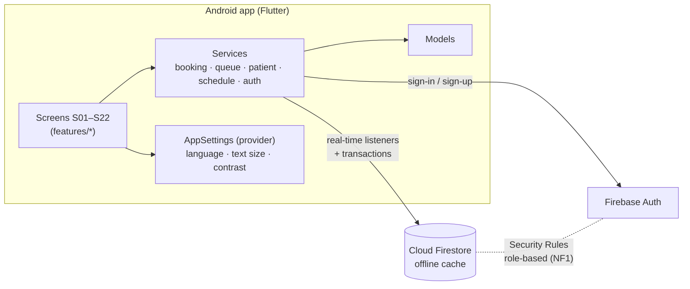

# Final Report Guide: IT3060HCI2026_Milestone03_Group WE_81

> **Read this first: the AI rule.** The brief says the report's AI content must be **under 50%** and that you must not copy AI output as-is. This guide therefore gives you **facts, tables and bullet notes**, not finished paragraphs. Write every paragraph **in your own words**, in your own style, using your own experience of building and testing the app. Tables of facts (stack, data model, test cases, traceability) are fine to adapt directly because they describe your actual system. Do the same for your own M01/M02 summaries: re-summarise them, don't paste.

**File name:** `IT3060HCI2026_Milestone03_GroupWE_81.pdf` · **Max 35 pages incl. cover** (references + appendix not counted).

---

## Suggested page budget (≈ 34 pages)

| # | Section | Pages | Lead writer |
|---|---|---|---|
| — | Cover page + member table (ID, name, workload for M01, M02, **M03**) | 1–2 | Lakmali |
| — | Table of contents | 1 | Lakmali |
| 1 | Executive summary | 1 | All (agree together) |
| 2 | Milestone 01 summary: problem, stakeholders, research, requirements F1–F5, NF1–NF4 | 3 | Nethmini |
| 3 | Milestone 02 summary: sketches → wireframes → lo-fi → hi-fi, design system, M02 test results | 3 | Lakmali |
| 4 | Tech stack selection & justification | 2.5 | Weerasinghe |
| 5 | System / app architecture | 2.5 | Weerasinghe |
| 6 | Implementation details & screenshots, **one subsection per member** + deviations table | 9 | Each member writes their own module |
| 7 | Traceability matrix (req → prototype → implementation → tests) | 1.5 | Lakmali |
| 8 | Functional test cases & results (summary table; full log → appendix) | 3 | Sithmini |
| 9 | Usability testing: plan, execution, results | 3.5 | Sithmini + Weerasinghe |
| 10 | Issues identified & fixes / recommendations | 1.5 | Sithmini |
| 11 | Gantt chart (M01–M03) | 1 | Lakmali |
| 12 | Conclusion & lessons learned | 1 | Nethmini |
| — | References / Appendix | (not counted) | |

**Fix the Milestone 02 slips this time**, because markers notice them: broken TOC entries ("Error! Bookmark not defined"), an "[N] participants" placeholder left in the text, the issue log naming screens that don't match the screen list (e.g. "S04 Doctor selection", "S07 Confirmation"), and requirement IDs written two ways (F1 vs FR-07). Use **F1–F5 / NF1–NF4** and **S01–S22** consistently.

---

## 1. Executive summary: points to cover
- Problem in one sentence (manual OPD booking, long unpredictable waits, missed turns).
- What was done in each milestone (research with 36 respondents → 22-screen prototype, SUS 79.5 → working Android app).
- Stack in one line (Flutter + Firebase Auth + Cloud Firestore).
- Key outcome numbers **from your M03 testing** (functional pass rate, usability success rate, SUS).
- One sentence on the main remaining limitation (no SMS gateway / IVR yet).

## 4. Tech stack: facts for your justification

| Layer | Chosen | Why it fits *this* project (link each to a requirement) | Alternatives considered → why not |
|---|---|---|---|
| Mobile framework | **Flutter 3.47 (Dart)** | One codebase for Android (now) and iOS (later); widget-level control to reproduce the M02 Figma design system exactly (colours, 48 dp targets, 12 px radius); built-in Material 3 accessibility (semantics, text scaling → NF2); good rendering of Sinhala/Tamil scripts (NF3); hot reload sped up 4 people working in parallel | **React Native**: JS bridge and more third-party UI libraries to match the design system; **Native Kotlin**: Android-only, slower to build 22 screens in 2 weeks; **Ionic/web**: weaker native feel and offline handling |
| Database | **Cloud Firestore** | **Real-time listeners** push queue changes to every phone in < 1 s with no polling (F2, NF4); offline cache keeps the last queue position visible on weak hospital Wi-Fi (M02 Priority-3 recommendation); transactions stop two patients getting the same token; one central database for all departments (F3, HMW 3) | **MySQL + REST API**: needs a server we would have to host and secure, plus WebSockets for live updates; **Realtime Database**: weaker querying and security-rule structure; **SQLite only**: not shared between staff and patients |
| Authentication | **Firebase Authentication (email/password)** | Secure password hashing and reset handled by Google; integrates directly with security rules (`request.auth`) for role-based access (S17, NF1) | Custom JWT auth (security risk for students to build); **Phone OTP**: needs the paid Blaze plan for SMS → deviation, see §6 |
| Authorisation | **Firestore Security Rules** + `config/access` staff code | Roles enforced on the server, not just hidden in the UI; patient cannot read other patients' data or flag themselves as priority (NF1) | App-side checks only (can be bypassed) |
| State management | **provider** | Simple, officially recommended, easy for every member to explain in the viva | Bloc/Riverpod: more boilerplate for a 2-week build |
| Hosting/cost | Firebase **Spark (free)** plan | Zero cost; enough quota for testing with 5–10 users | Paid cloud server |
| Version control | Git + GitHub | Required by brief; branches per member module | — |
| Testing | `flutter_test` unit tests + manual test cases | Business rules (queue order, wait, NIC) tested automatically | — |

Constraints to mention: 2-week timeframe, 4 developers new to some of the stack, zero budget, Android phones most common among respondents (M01 Q12: 83.3% comfortable with a mobile app).

## 5. Architecture: material

Client–serverless architecture: the Flutter app talks directly to Firebase; security rules are the "backend logic" for access control.

Draw this yourselves in draw.io/Figma for the report (consistent with your M02 visuals).

**Data model (Firestore collections)**

| Collection | Key fields | Used by |
|---|---|---|
| `users/{uid}` | name, email, phone, role (patient/staff/admin), patientId, language, textScale, highContrast, lastHospitalId | S17, S22, S01 |
| `hospitals/{id}` | name, district, address | S01, S18 |
| `sessions/{id}` | hospital, department, doctor, room, date, dateKey, start/end, capacity, bookedCount, lastToken, tokenPrefix, avgConsultMinutes, status, reminder settings, **waitingIds[]** (ordered live queue), **currentServingId** | S02, S07, S08–S12, S18–S21 |
| `appointments/{id}` | patientUid, patientId, session copy fields, tokenNumber/Label, status (waiting/serving/completed/cancelled/noShow), channel (app/walkIn/phone), priority + reason, reminder flags, arrived | S02–S12 |
| `patients/{id}` + `visits/{id}` | NIC, phone, DOB, gender, blood group, allergies, archived + note, linkedUid · visit date/department/doctor/diagnosis/notes | S09, S11, S13–S16 |
| `notifications/{id}` | uid, title, body, type, read | S19, S07b, S20–S21 |
| `auditLogs/{id}` | patientId, action, note, byUid, byName, at | S13, S15, S16 |
| `config/access` | staffCode, adminCode (server-only) | S17 |

**Key design decisions worth explaining (good viva material)**
1. The live queue lives on the **session document** (`waitingIds`, `currentServingId`). A patient reads one document to see their position and never needs access to other patients' appointments, so privacy (NF1) and speed (NF4) come from the same decision.
2. **Transactions** for booking/reschedule/cancel/call-next → no duplicate tokens, no overbooking even if two people book at the same second.
3. **No composite indexes**: queries use single equality filters and sort on the device, so setup is simpler.
4. **Soft delete** (archive) for patient records + append-only audit log.
5. Business rules isolated in `core/logic.dart` → unit-testable without Firebase.

## 6. Implementation: per-member subsection template
For each member: (a) screens owned, (b) **2+ CRUD operations per screen** (use the README table), (c) 2–4 screenshots placed beside the M02 hi-fi frame of the same screen, (d) one interesting technical point you can explain, (e) deviations from the prototype.

| Member | Screens | Code |
|---|---|---|
| Lakmali M.A.D.M (IT23679344) | S01–S07 (S07a/b/c) | `features/patient/`, `services/booking_service.dart` |
| P.A.J. Sithmini (IT23671874) | S08–S12 | `features/reception/`, `services/queue_service.dart` |
| Weerasinghe W.D.S.U (IT23685802) | S13–S17 | `features/records/`, `features/auth/`, `services/patient_service.dart`, `auth_service.dart`, `firestore.rules` |
| Nethmini K (IT23669130) | S18–S22 | `features/schedule/`, `services/schedule_service.dart` |

### Deviations from the M02 high-fidelity prototype (must be documented and justified)

| # | Screen | Prototype | Implemented | Justification |
|---|---|---|---|---|
| D1 | S17 | Login with SMS OTP | Email + password, email verification, staff **access code** for staff/admin roles | Firebase phone-auth SMS needs the paid Blaze plan; email verification gives a free second factor for account ownership; the access code adds role security the prototype didn't have (NF1) |
| D2 | F4 / S03, S19 | SMS / call reminders | In-app notification centre + in-app alert with sound/vibration; reminders created when the app opens within the reminder window; near-turn and change/cancel notices sent the moment staff act | SMS gateway and scheduled Cloud Functions both need paid plans; already flagged as "beyond prototype scope" in M02 §11. Planned as future work |
| D3 | Staff screens | (Trilingual implied) | Patient screens EN/SI/TA; staff screens English | Staff in M01 sample work with English registers; translating staff UI was deprioritised for the timeframe |
| D4 | S10 | Listed under both Lakmali and Sithmini in M02 | Implemented once in the reception module (Sithmini); Lakmali implemented the three live-queue states S07a/b/c | Removes duplicate ownership; S10 is a staff action |
| D5 | S02 → S03 | Step 3 as a separate page | Step 3 (review & confirm) as a bottom sheet over S02 | Keeps the chosen day visible behind the sheet; one tap fewer; back is a swipe |
| D6 | S07 | Timed transitions simulated the live feed | Real Firestore listeners; added "I'm at the hospital" button and estimated wait | Real-time data replaces simulation (F2); estimated wait fixes M02 issue U6; arrival flag helps reception skip absent patients |
| D7 | S09 | Walk-in only | Same screen also does **phone/assisted booking** for a future day | Covers F1's phone/assisted channel without a separate IVR system |
| D8 | S14, S16 | Profile, archive | Added visible **audit trail** and **restore** | NF1 accountability; Staff Q9 concern about recovering from mistakes |
| D9 | S01 | Fixed list | Added search + "Last used" hospital first | Fewer decisions for repeat visitors (Harmanis persona) |
| D10 | — | Doctor selection screen (named in M02 issue log) | Doctor is part of the clinic session card | Government OPD patients choose a clinic day, not a specific doctor |

Add any further differences you notice when you place your screenshots beside the Figma frames.

## 8. Functional testing: how to present
- Summary table: per module → number of TCs, passed, failed, fixed and re-tested.
- Highlight 3–5 interesting failures you found and how you fixed them (this is the "evidence" markers look for).
- Automated: "17 unit tests, all passing", with a screenshot of the `flutter test` output.
- Full TC table (docs/TEST_CASES.md with your actual results) → appendix.

## 9. Usability testing: present your real results
- Plan (from USABILITY_TEST_KIT.md §1), participant table, tasks.
- Results table: success %, mean time vs target, mean SEQ per task.
- SUS per participant + mean, **compared with M02's 79.5**, with your explanation.
- 3–5 short participant quotes.
- Issue log with severity → section 10.

## 11. Gantt chart: Milestone 03 tasks (28 Sep – 9 Oct 2026)

Rebuild the chart in the same style as M01/M02 and include all three milestones on one overall timeline. Use your real dates; the rows below are only a starting list.

| Task | Owner |
|---|---|
| Review M02 prototype + traceability to M01 | All |
| Tech stack decision + Firebase project setup | Weerasinghe |
| Design system in code (theme, components) | Lakmali |
| Module implementation S01–S07 / S08–S12 / S13–S17 / S18–S22 | Each member |
| Security rules + role testing | Weerasinghe |
| Integration + demo data | Nethmini |
| Functional test execution + bug fixing | Sithmini (all) |
| Usability sessions (5 participants) | Sithmini, Weerasinghe |
| Fixes from usability findings + re-test | All |
| APK build, README, GitHub | Lakmali |
| Final report compilation + viva prep | All |

## 12. Lessons learned: prompts (answer honestly, in your own words)
- What did the working app reveal that the Figma prototype could not (real timing, real typing, real network)?
- Which M02 design decision proved right once real users touched it? Which didn't?
- What would you change about the technology choice if you started again?
- How did the shared design system/codebase help four people work in parallel?

## Viva preparation (each member)
Be ready to: demo your screens end-to-end on the APK; point to your CRUD operations in code; explain one transaction or security rule in your module; explain why Flutter + Firestore; give your usability numbers and one issue you fixed.

## Appendix checklist
- A: GitHub repository link + APK link (Drive)
- B: Full functional test log with actual results + screenshots
- C: `flutter test` output
- D: Usability consent forms, SUS forms, session notes, recording links
- E: Additional screenshots (EN / SI / TA, high-contrast, large text)
- F: Firestore security rules (`firestore.rules`)
- G: Selected source code excerpts (one per member)
